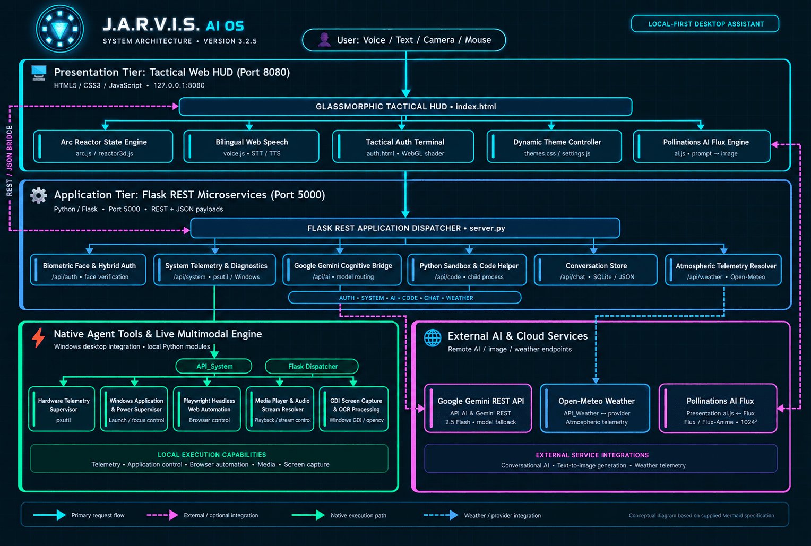
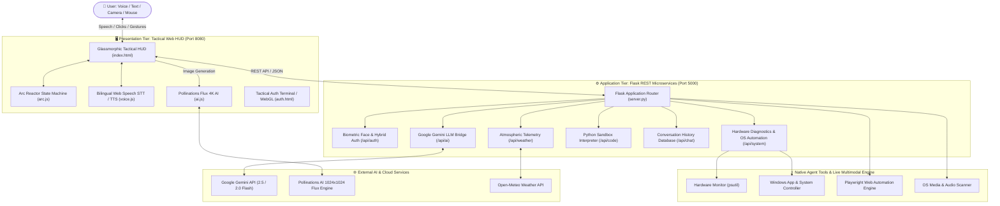

# 🌐 J.A.R.V.I.S. AI OS v3.3.0

[](https://www.linkedin.com/in/rohit-kumar-gupta-a96b8428a/)
[](https://github.com/Rohitkumar-3103/Jarvis)
[](https://www.python.org/)
[](LICENSE)
[](https://github.com/Rohitkumar-3103/Jarvis)

Welcome to **J.A.R.V.I.S. (Just A Rather Very Intelligent System)**—an advanced automated full-stack AI assistant and tactical desktop operating system inspired by the Stark Industries Mark XLVII interface.

> 📚 **Context & Architecture Documentation for AI Agents & Developers:**
>
> - 🤖 **[AGENTS.md](AGENTS.md)** — Core Mental Model, System Invariants & AI Agent Context
> - 🏗️ **[PROJECT_OVERVIEW.md](PROJECT_OVERVIEW.md)** — Full Subsystem Architecture & Module Mapping
> - 🔌 **[API Documentation](docs/API_Documentation.md)** — Complete REST API Reference
> - 🛠️ **[Developer Guide](docs/DEVELOPER_GUIDE.md)** — Setup, Extension & Testing Handbook
> - 🎨 **[Design Specifications](docs/DESIGN.md)** — UI/UX, Typography & Color Wheel System

---

## 🚀 Key Features

- **Holographic Glassmorphic UI**: A desktop dashboard featuring neon glowing accents, diagnostic status logs, a digital clock, battery metrics, and animated HUD scanning lines.
- **Dual Input Modes**: Interact via voice commands (Web Speech Recognition) or direct text commands in the terminal bar.
- **Interactive Arc Reactor Core**: A central reactor orb that reacts visually to different states:
  - 🔵 `STANDBY` (Pulsing Cyan)
  - 🔴 `LISTENING` (Active Ring Pulsing Red)
  - 🟣 `SYNAPSING` (Fast Rotating Purple)
  - 🟢 `VOCALIZING` (Speech-synced Green)
- **Speech Synthesis (TTS)**: J.A.R.V.I.S. speaks back to you with custom speed (synaptic rate) and pitch controls, using your device's built-in system voices.
- **Gemini Cognitive Integration**: Paste your Gemini API key inside the settings modal to unlock true generative AI conversation capabilities.
- **Local Action Routing**: Command J.A.R.V.I.S. to perform local machine operations like opening Google, YouTube, Calculator, setting/navigating to a favorite website, or reading out the current date and time.
- **Persistent Configuration**: Settings (voice models, rate, API keys, favorite URLs) are saved directly in your browser's local storage.
- **3D Celestial Core & 9-Planet Keplerian Matrix**: Real-time WebGL/Three.js celestial orb surrounded by authentic Keplerian elliptical orbits for all 9 planets (Mercury through Pluto), procedural atmospheric shaders, and interactive camera orbital controls.
- **Touchless Optical Air Gestures**: In-browser local MediaPipe machine learning worker that tracks hands via webcam to seamlessly rotate the 3D scene, pinch-to-zoom, and cycle viewpoints without any physical touch or cloud data transfer.
- **Tactical Hologram Communications (Direct Satellite Comms)**: Stark Industries Mark XLVII direct video & voice communication module featuring a widescreen crystal clear video stage (`540px` x `310px`), top-right live call duration timer overlay, Stark identity banner with glowing diamond reticles (`◈`), dedicated mic/camera controls, and 1-click WhatsApp (`wa.me`) / Phone Call (`tel:`) routing.
- **Tactical Biometric & Master PIN Security**: Dual-layer OpenCV Haar Cascade facial recognition coupled with an emergency Master PIN (`2710`) manual bypass terminal.

---

## 🛠️ Technology Stack

- **Structure**: HTML5 (Semantic modules, modal dialogues)
- **Styling**: CSS3 (Custom properties, CSS Grid/Flexbox layouts, Backdrop blur filters, Keyframe animations)
- **Logic**: JavaScript (ES6+, asynchronous fetch API, Web Speech API integration)
- **Backend Services**: Python 3.12 Flask REST API, OpenCV Biometrics, `psutil` Telemetry
- **AI Engine**: Google Gemini API (`gemini-2.5-flash`, `gemini-2.0-flash`, `gemini-1.5-flash`), Pollinations Flux 4K Generator

---

## 🏛️ System Architecture & Design

J.A.R.V.I.S. operates on a decoupled multi-tier architecture uniting a low-latency client-side Web HUD with a local Python Flask REST node and cloud AI services:





> 📖 **Deep-Dive Architecture & Design Specifications:**
>
> - 🏛️ **[System Architecture Blueprint](docs/ARCHITECTURE.md)** — Multi-tier topology, microservices mapping, execution flows, and security invariants.
> - 🎨 **[Tactical HUD Design System](docs/DESIGN.md)** — Glassmorphic styling, 360° theme palettes, tonal stacking, and typography tokens.

---

## 📁 Project Structure

```text
Jarvis/
│
├── 🚀 ORCHESTRATION & PACKAGING
│   ├── run_dashboard.py            # Main Full-Stack Launcher (Backend Port 5000 + Web HUD Port 8080)
│   ├── main.py                     # Standalone PyQt6 Live Gemini Multimodal Audio Client
│   ├── ui.py                       # Sci-Fi PyQt6 Desktop Client GUI
│   ├── setup.py                    # Setuptools Packaging Specification
│   ├── package.json                # Project Metadata & NPM Scripts
│   ├── requirements.txt            # Python Dependencies Manifest
│   ├── requirements-docker.txt     # Minimal Containerized Dependencies
│   ├── Dockerfile                  # Container Deployment Blueprint
│   ├── docker-compose.yml          # Multi-Container Compose Configuration
│   ├── .env                        # Local Secret Variables (Ignored by Git)
│   ├── .env.example                # Sample Environment Configuration Template
│   └── .gitignore                  # Git Version Control Ignore Rules
│
├── 📚 DOCUMENTATION & BLUEPRINTS
│   ├── README.md                   # Primary GitHub Presentation & Quickstart Guide
│   ├── AGENTS.md                   # AI Assistant Mental Model, Architecture Rules & Invariants
│   ├── PROJECT_OVERVIEW.md         # Full Subsystem Architecture & Module Mapping
│   ├── JARVIS_TECHNICAL_PROJECT_REPORT.md  # Formal Technical & Academic System Report
│   ├── JARVIS_Project_Details.pdf  # Master PDF Documentation Specification
│   ├── LICENSE                     # MIT Open-Source License
│   ├── CHANGELOG.md                # Release History & Version Logs
│   ├── CONTRIBUTING.md             # Developer Contribution Guidelines
│   └── docs/                       # Technical Manuals & Subsystem Specifications
│       ├── API_Documentation.md    # Complete REST API Endpoint Reference
│       ├── ARCHITECTURE.md         # Multi-Tier System Topology & Sequence Diagrams
│       ├── DESIGN.md               # Mark XLVII HUD Design Specifications & Tokens
│       ├── DEVELOPER_GUIDE.md      # Developer Setup & Extension Handbook
│       ├── INSTALLATION.md         # Step-by-Step Installation Handbook
│       ├── PYTHON_TUTORIAL.md      # Python Codebase Tutorial & Scripting Guide
│       └── USER_GUIDE.md           # User Operation & Voice Commands Handbook
│
├── 🖥️ FRONTEND (TACTICAL HUD WEB CLIENT — PORT 8080)
│   ├── index.html                  # Main Glassmorphic Tactical HUD Dashboard
│   ├── auth.html                   # Biometric Auth Terminal (WebGL GLSL Shader)
│   ├── favicon.ico                 # App Favicon
│   │
│   ├── css/                        # Modular Stylesheets (10 Files)
│   │   ├── style.css               # Core Styles & Layout Tokens
│   │   ├── dashboard.css           # HUD Panels, Arc Reactor & Tactical Call Comms
│   │   ├── chat.css                # AI Chat Bubbles & Code Prism Viewers
│   │   ├── lockscreen.css          # Biometric Face Scan & Passcode Pad
│   │   ├── settings.css            # Tactical Slide-Out Settings Panel
│   │   ├── widgets.css             # Circular Gauges & Telemetry Blocks
│   │   ├── themes.css              # 360° Theme Engine & Color Swatches
│   │   ├── animations.css          # Keyframes, Radar Pulses, Glowing Effects
│   │   ├── responsive.css          # Mobile / Tablet Viewport Queries
│   │   └── all.min.css             # Local FontAwesome 6.5.2 Icon Suite
│   │
│   ├── js/                         # Frontend Execution Engines (13 Modules)
│   │   ├── app.js                  # Master Controller, Comms & Audio Routing
│   │   ├── ai.js                   # Gemini LLM Bridge & Pollinations 4K Flux Engine
│   │   ├── voice.js                # Bilingual Web Speech Recognition & TTS
│   │   ├── commands.js             # Voice & Text Intent Classifier
│   │   ├── dashboard.js            # HUD Widgets, Drawer & Telemetry Streams
│   │   ├── chat.js                 # Message Stream, PDF Export & Code Zoom
│   │   ├── lockscreen.js           # Biometric Face Verification & Master PIN (2710)
│   │   ├── settings.js             # Profile Sync & Color Wheel Controller
│   │   ├── weather.js              # Live Radar & Atmospheric Resolver
│   │   ├── reactor3d.js            # 3D Arc Reactor State Machine
│   │   ├── storage.js              # LocalStorage Persistent Sync
│   │   ├── animations.js           # Micro-Interactions & Particle Dynamics
│   │   └── utils.js                # DOM Selectors, Audio Chimes & Helpers
│   │
│   └── assets/                     # Media & Static Assets
│       ├── images/                 # Avatars, Logos, App Icons
│       ├── icons/                  # HUD Vector Icons
│       └── sounds/                 # Tactical HUD Sound Effects
│
├── ⚙️ BACKEND (FLASK REST MICROSERVICES — PORT 5000)
│   ├── server.py                   # Primary Flask WSGI Application Entry Point
│   ├── server_config.py            # Server Ports, Host & Environment Flags
│   │
│   ├── api/                        # REST Blueprints
│   │   ├── __init__.py             # Blueprint Package Export
│   │   ├── ai.py                   # Google Gemini REST Relay
│   │   ├── auth.py                 # Face Verification, Hybrid Auth & OTP
│   │   ├── calls.py                # Direct Satellite Voice/Video Call Relay
│   │   ├── chat.py                 # Chat History Persistence & Flushes
│   │   ├── code.py                 # Python Code Interpreter Sandbox
│   │   ├── files.py                # Dataset Upload & Document Processing
│   │   ├── system.py               # Hardware Diagnostics & OS Automation
│   │   └── weather.py              # Atmospheric Open-Meteo Gateway
│   │
│   ├── automation/                 # Native OS Automation
│   │   ├── os_controls.py          # Windows Application & Master Controls
│   │   ├── system_monitoring.py    # Real-Time Telemetry & Hardware Diagnostics
│   │   ├── adb_controls.py         # Android Debug Bridge Device Controls
│   │   └── voice_commands.py       # Local Voice Command Dispatcher
│   │
│   ├── database/                   # Storage Layer
│   │   ├── db_manager.py           # SQLite & JSON Conversation Database Manager
│   │   ├── favorites.json          # Quick-Launch Favorite Applications
│   │   ├── reminders.json          # Scheduled Reminders & Events
│   │   └── settings.json           # Backend Runtime Configuration Cache
│   │
│   └── data/                       # User Records
│       ├── users.json              # Local Biometric & User Profile Store
│       └── users.json.example      # Sample User Account Blueprint
│
├── 🧠 CORE (MULTIMODAL LIVE ENGINES)
│   ├── __init__.py                 # Engine Package Exports
│   ├── llm.py                      # Multi-Model LLM Orchestration
│   ├── stt.py                      # Offline Whisper & Vosk Speech-to-Text
│   ├── tts.py                      # EdgeTTS, Kokoro & ElevenLabs Voices
│   ├── prompt.txt                  # Master Persona & System Instructions
│   ├── installer.py                # Dynamic Dependency Installer
│   └── startup.py                  # Initialization & System Boot Sequence
│
├── ⚡ ACTIONS (NATIVE AGENT TOOL SUITE)
│   ├── __init__.py                 # Tool Exports
│   ├── browser_control.py          # Playwright Headless Web Automation
│   ├── code_helper.py              # Local Python Sandbox & CP Helper
│   ├── computer_control.py         # Process Supervisor & System Power
│   ├── computer_settings.py        # Windows Audio, Display & Network
│   ├── desktop.py                  # Window Placement & Desktop Automation
│   ├── dev_agent.py                # Autonomous Coding Workflow Agent
│   ├── file_controller.py          # Safe Filesystem Controller & Search
│   ├── file_processor.py           # Document Summarization & Parsing
│   ├── flight_finder.py            # Flight Schedules & Travel Lookups
│   ├── game_updater.py             # Game Supervisor & Launcher
│   ├── messaging.py                # Encrypted Comms & Email Dispatch
│   ├── music.py                    # Multi-Directory Music Scanner & Player
│   ├── open_app.py                 # Application & URI Dispatcher
│   ├── proactive.py                # Background Context Monitoring
│   ├── reminder.py                 # Task Scheduling & Event Reminders
│   ├── screen_processor.py         # .NET GDI Screen Capture & OCR
│   ├── system_monitor.py           # Real-Time CPU/RAM/Temp Telemetry
│   ├── weather.py                  # Meteorological Data Provider
│   ├── web_search.py               # Live News & Web Intelligence
│   └── youtube.py                  # YouTube Audio/Video Streaming
│
├── 💾 MEMORY & CONFIG
│   ├── memory/
│   │   ├── memory_manager.py       # Conversation Context Store
│   │   ├── config_manager.py       # Setting & API Key Resolver
│   │   ├── user_profile.json       # Active Profile Manifest
│   │   └── conversation.json       # Local Conversation Session Logs
│   └── config/
│       ├── api_keys.json.example   # Configuration Template
│       ├── environment.py          # Cross-Platform Resolver
│       └── jarvis.ico              # Native App Icon
│
└── 🧪 TESTS & VERIFICATION
    ├── tests/
    │   ├── test_actions.py         # Native Agent Tool Unit Tests
    │   ├── test_ai.py              # AI Provider & Fallback Tests
    │   ├── test_api.py             # Flask REST Routes Verification
    │   ├── test_auth.py            # Authentication & OTP Unit Tests
    │   ├── test_backend.py         # Hardware Diagnostics & OS Tests
    │   └── test_voice.py           # STT & TTS Configuration Tests
    ├── screenshots/                # High-Resolution HUD Interface Captures
    └── demo/                       # Video Previews & Animation Assets
```

---

## ⚡ Quickstart & Virtual Environment Setup

### 1. Create and Activate `.venv`

#### 🪟 Windows (PowerShell)

```powershell
# 1. Create Python 3.12 Virtual Environment
py -3.12 -m venv .venv

# 2. Activate Virtual Environment
.\.venv\Scripts\Activate.ps1

# 3. Install Dependencies
pip install -r requirements.txt
```

#### 🪟 Windows (Command Prompt)

```cmd
# 1. Create Virtual Environment
py -3.12 -m venv .venv

# 2. Activate Virtual Environment
.\.venv\Scripts\activate.bat

# 3. Install Dependencies
pip install -r requirements.txt
```

#### 🐧 Linux / 🍎 macOS

```bash
# 1. Create Virtual Environment
python3 -m venv .venv

# 2. Activate Virtual Environment
source .venv/bin/activate

# 3. Install Dependencies
pip install -r requirements.txt
```

---

## 🚀 Launching J.A.R.V.I.S.

### 🌟 Unified Dual-Server Launcher (Recommended)

With your virtual environment active, run:

```powershell
python .\run_dashboard.py
```

This automatically initializes:

- ⚙️ **Flask REST API Service**: `http://127.0.0.1:5000`
- 🖥️ **Tactical Glassmorphic Web HUD**: `http://127.0.0.1:8080` (or `8081`)
- 🌐 **Auto-opens** your default browser directly into the HUD.

### 🎙️ Standalone Multimodal Live Audio Client (PyQt6 Desktop)

```powershell
python main.py
```

### 🧪 Run Automated Tests

```powershell
pytest
```

---

## 🗣️ Voice Commands Guide

| Command                                  | Action / Response                                                                              |
| :--------------------------------------- | :--------------------------------------------------------------------------------------------- |
| `"Hey J.A.R.V.I.S."` / `"Hello"`         | Greets you and checks system diagnostic logs.                                                  |
| `"What time is it?"`                     | Reads out and prints the current system time.                                                  |
| `"What is the date?"`                    | Reads out and prints today's date.                                                             |
| `"Open Google"`                          | Opens Google in a new browser tab.                                                             |
| `"Open YouTube"`                         | Opens YouTube in a new browser tab.                                                            |
| `"Open WhatsApp"`                        | Opens WhatsApp Web and calls backend launch.                                                   |
| `"Open GitHub"`                          | Opens GitHub in a new browser tab.                                                             |
| `"Open File Explorer"` / `"Open File"`   | Launches native Windows File Explorer.                                                         |
| `"Open VS Code"` / `"Open code file"`    | Opens VS Code editor in the current project workspace.                                         |
| `"Open Calculator"`                      | Launches your operating system's native calculator application.                                |
| `"Play Music"` / `"Music"`               | Opens YouTube Music and executes backend play.                                                 |
| `"Send Email"` / `"Email"`               | Opens Gmail composer and launches local mail.                                                  |
| `"Open Notepad"` / `"Notepad"`           | Opens native Windows Notepad application.                                                      |
| `"Take Screenshot"` / `"Screenshot"`     | Captures full screen and saves to `Assets/screenshot.png`.                                     |
| `"Shutdown System"` / `"Shutdown"`       | Initiates a 60-second host computer shutdown countdown.                                        |
| `"Abort Shutdown"` / `"Cancel Shutdown"` | Cancels the active system shutdown timer.                                                      |
| `"Set favorite website to [URL]"`        | Registers a target URL in localStorage (e.g. `set favorite website to github.com`).            |
| `"Open favorite website"`                | Opens your registered favorite URL.                                                            |
| _[Any general query]_                    | If a Gemini API key is configured, queries the LLM. If offline, launches a Google search scan. |

---

## ⚙️ Connecting the Gemini AI Layer

1.  Obtain a free **Google Gemini API Key** from [Google AI Studio](https://aistudio.google.com/).
2.  Open the settings slider panel in the bottom-right corner of the J.A.R.V.I.S. dashboard.
3.  Paste your API key into the **Gemini Intelligence Link** field.
4.  Click **Apply Configuration**.
5.  _J.A.R.V.I.S._ is now fully sentient! Ask him complex questions, write code, or have general conversations.

---

## 🔍 How It Works (Code Architecture)

### Speech Recognition (Speech-to-Text)

Browser audio is processed via the `webkitSpeechRecognition` constructor. J.A.R.V.I.S. listens, outputs text to the chat bubble, and forwards it to the command processor:

```javascript
const SpeechRecognition =
  window.SpeechRecognition || window.webkitSpeechRecognition;
const recognition = new SpeechRecognition();

recognition.onresult = (event) => {
  const transcript = event.results[0][0].transcript;
  takeCommand(transcript);
};
```

### Cognitive API Routing

If an API key exists, J.A.R.V.I.S. sends a payload containing a system role instruction to ensure the AI speaks under the J.A.R.V.I.S. persona:

```javascript
const requestPayload = {
  contents: [{ parts: [{ text: promptText }] }],
  systemInstruction: {
    parts: [
      {
        text: "You are J.A.R.V.I.S., the legendary advanced AI system. Speak politely, use terms like 'Sir', and keep responses extremely crisp, informative, and to-the-point (under 3-4 sentences max) so they translate perfectly to voice feedback.",
      },
    ],
  },
};
```

### Speech Synthesis (Text-to-Speech)

Responses are spoken back using custom voice options populated from `window.speechSynthesis.getVoices()`:

```javascript
const utterance = new SpeechSynthesisUtterance(cleanSpeechText);
utterance.voice = selectedVoiceProfile;
utterance.pitch = voicePitch;
utterance.rate = voiceRate;
window.speechSynthesis.speak(utterance);
```

---

## 👨‍💻 Author & Connect

**Rohit Kumar Gupta**  
_Creator & Lead Developer of J.A.R.V.I.S. AI OS_

[](https://www.linkedin.com/in/rohit-kumar-gupta-a96b8428a/)
[](https://github.com/Rohitkumar-3103/Jarvis)

- 💼 **LinkedIn**: [linkedin.com/in/rohit-kumar-gupta-a96b8428a](https://www.linkedin.com/in/rohit-kumar-gupta-a96b8428a/)
- 🐙 **GitHub**: [github.com/Rohitkumar-3103](https://github.com/Rohitkumar-3103)
- 🚀 **Project Repository**: [github.com/Rohitkumar-3103/Jarvis](https://github.com/Rohitkumar-3103/Jarvis)

---

## 📄 License

This project is open-sourced under the **MIT License** — see the [LICENSE](LICENSE) file for complete details.
